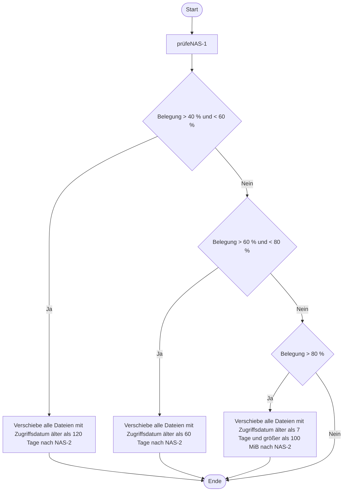

```markdown
## 1. Aufgabe (Speichersysteme & RAID)

### a) RAID-Controller Merkmale
*   **Cache-Größe (Cache Size):** Bestimmt die Menge an Daten, die für Lese-/Schreibvorgänge gepuffert werden kann; größerer Cache reduziert Latenz und erhöht die IOPS.
*   **Anzahl der Ports (Channels/Ports):** Definiert die maximale Anzahl an anschließbaren Laufwerken und den möglichen Durchsatz pro Kanal; verhindert Flaschenhälse (Bottlenecks).
*   **Schnittstellentyp (z.B. PCIe 4.0, SAS 12G):** Bestimmt die maximale Bandbreite zum Host-System; ein veralteter Bus limitiert die Performance der SSDs/HDDs.
*   **RAID-Level Support:** Muss die benötigten Level (5, 6, 10) unterstützen.
*   **Batteriepufferung (BBU/NVRAM):** Schützt den Write-Cache bei Stromausfall; verhindert Datenverlust und ermöglicht Write-Back-Caching (Performance).

### ab) Fehlertoleranter RAID-Level mit höchster Schreibdatenrate
*   **RAID 10 (1+0):** Stripping über Mirrors. Schreibvorgänge erfolgen parallel auf die gespiegelten Platten; kein Parity-Berechnungs-Overhead (im Gegensatz zu RAID 5/6).
*   **RAID 1:** Höchste Schreibrate bei 2 Platten, aber geringe Kapazität. RAID 10 skaliert besser.
*   **Falsch:** RAID 5/6 (Parity-Berechnung kostet Performance bei Write), RAID 0 (nicht fehlertolerant).

### ac) Fehlertoleranter RAID-Level mit größter Nettokapazität
*   **RAID 5:** Nutzt Single-Parity. Nettokapazität = (N-1) * Plattenkapazität. Bietet den besten Kompromiss aus Fehlertoleranz (1 Platte) und Kapazitätsverlust.
*   **Falsch:** RAID 6 (2 Parity-Platten, mehr Verlust), RAID 10 (50% Verlust), RAID 1 (50% Verlust).

### ad) Benchmark-Testbedingungen (Verfälschung)
*   **Netzwerk-Flaschenhals:** Wenn der Test über 1 Gbit/s LAN läuft, aber das NAS 10 Gbit/s kann, misst man das Netzwerk, nicht das NAS (OSI Layer 1/2 Limit).
*   **Cache-Effekte:** Wenn das NAS einen großen RAM-Cache hat und die Testdatei kleiner als der Cache ist, wird alles aus dem RAM gelesen; die Festplatten werden nicht belastet (keine echte I/O-Messung).
*   **Parallelität:** Single-Threaded Tests lasten moderne Multi-Core-Controller nicht aus; man muss Queue-Tiefe (QD) und Threads simulieren, um realistische IOPS zu messen.

---

## (Datenbank & SQL)

### ba) Kardinalitäten (ERM)
*   **Windpark (1) -> Windrad (N):** Ein Windpark hat viele Windräder. Ein Windrad gehört zu genau einem Windpark (Fremdschlüssel IDWindpark).
*   **Windrad (1) -> Betriebsdaten (N):** Ein Windrad erzeugt viele Betriebsdaten (Logs). Ein Betriebsdatensatz gehört zu genau einem Windrad.

### b) Referentielle Integrität
*   **Aktivieren:** Verhindert verwaiste Datensätze (Orphans). Ein Betriebsdatensatz kann nicht ohne zugehöriges Windrad existieren.
*   **SQL-Effekt:** `INSERT` in Betriebsdaten schlägt fehl, wenn `IDWindrad` nicht in der Tabelle `Windrad` existiert. `DELETE` eines Windrads schlägt fehl, solange Betriebsdaten existieren (oder kaskadiert).

### bc) SQL: Anzahl Windräder in Park 102
```sql
SELECT COUNT(*) FROM Windrad WHERE IDWindpark = 102;
```
*   `COUNT(*)` zählt die Zeilen. `WHERE` filtert den Fremdschlüssel.

### bd) SQL: Top 3 Windräder nach Tagesleistung am 03.05.2022
```sql
SELECT IDWindrad 
FROM Betriebsdaten 
WHERE Datum = '2022-05-03' 
ORDER BY TagesErzeugung DESC 
LIMIT 3;
```
*   `ORDER BY ... DESC` sortiert absteigend (höchste Leistung zuerst). `LIMIT 3` schneidet die Top 3 ab. (Alternativ: `TOP 3` je nach DBMS).

---
## 2. UML - Pseudocode 

Aktivitäts digramm



Bubblesort-Alg.

```bash
// Zeile 1-4 (gegeben)
int[] werte = { 30, 24, 12, 50, 11, 49, 11 };
int temp;
int len = werte.Length;

for (int p = 0; p <= len - 2; p++) {     // äußere Schleife
    for (int i = 0; i < len - 1 - p; i++) { // Zeile 5: innere Schleife
        if (werte[i] > werte[i + 1]) {      // Zeile 6: Vergleich
            temp = werte[i];                // Zeile 7: Tausch
            werte[i] = werte[i + 1];        // Zeile 8: Tausch
            werte[i + 1] = temp;            // Zeile 9: Tausch
        }
    }                                       // Zeile 10: Ende Vergleich und Tausch
}                                           // Zeile 11: Ende innere Schleife
                                            // Zeile 12: Ende äußere Schleife
```
---

## 3. Aufgabe (WLAN & Webcams)

### a) WLAN-Vorteile
*   **Flexibilität/Mobilität:** Keine Verkabelung nötig; einfache Positionsänderung der Kameras (OSI Layer 1 Unabhängigkeit).
*   **Kosteneffizienz:** Keine Verlegung von Netzwerkkabeln (Material- und Arbeitskosten).
*   **Skalierbarkeit:** Schnelles Hinzufügen neuer Geräte ohne physische Ports am Switch.
*   **Multi-Zuweisung:** Einfachere Zuweisung an AP/Server.


### ba) Webcam-Auswahl
*   **24h Außenüberwachung mit Publikum:** **Neocam BVR** oder **SecretAV-NBX**. Begründung: **Infrarot-Nachtsicht** (24h) und **Vandalismusschutz** (Publikum). Neocam hat bessere Auflösung, SecretAV hat WPA3. Entscheidung: **Neocam BVR** (Full HD + IR + Vandalismus).
*   **Webkonferenzen höchste Bildqualität:** **HD-Sec**. Begründung: **4K-Auflösung** und **60 fps** (flüssige Bewegung). Hohe Auflösung ist hier entscheidend.
*   **Serverraum (sicherste Verschlüsselung):** **SecretAV-NBX**. Begründung: **WPA3** ist der aktuell sicherste WLAN-Standard (schützt vor Brute-Force/Handshake-Angriffen). WPA/WPA2 sind veraltet/unsicher.

### bb) Datenmenge pro Webcam pro Minute
*   **Formel:** (Pixel * Farbtiefe * fps * Zeit) / 8 (für Byte) / 1024^2 (für MiB).
*   **Rechnung:** 1920 * 1080 * 16 Bit * 10 fps * 60 s = 19.906.560.000 Bit.
*   **Umrechnung:** 19.906.560.000 / 8 = 2.488.320.000 Byte.
*   **In MiB:** 2.488.320.000 / 1024 / 1024 ≈ 2373 MiB.
*   **Runden:** **2373 MiB** (pro Minute). *Hinweis: 5 Stunden Überwachung sind für "pro Minute" irrelevant.*

### bc) DSGVO-Begriffe
*   **Löschfristen:** Daten dürfen nicht länger gespeichert werden als nötig. Nach Ablauf der Frist (z.B. 48h) müssen die Videodateien unwiderruflich gelöscht werden (Art. 5 DSGVO).
*   **Persönlichkeitsrecht:** Videoüberwachung greift in das Recht am eigenen Bild ein. Nur zulässig, wenn öffentliche Interessen überwiegen und keine milderen Mittel (z.B. Zaun) existieren.
*   **Zweckbindung:** Daten dürfen nur für den deklarierten Zweck (Sicherheit) genutzt werden. Nicht zur Leistungskontrolle von Mitarbeitern (Art. 5 DSGVO).

---

## 4. Aufgabe (Betriebssystem & Virtualisierung)

### a) Sicherheitsmerkmale Betriebssystem
*   **Benutzerkontensteuerung (UAC):** Verhindert unautorisierte Änderungen; Programme laufen mit niedrigen Rechten, Admin-Rechte werden prompt abgefragt.
*   **BitLocker (Festplattenverschlüsselung):** Schützt Daten bei physischem Diebstahl; verschlüsselt das Volume (AES).
*   **Windows Defender / Antivirus:** Echtzeitschutz vor Malware; signaturbasiert und heuristisch.
*   **Windows Update:** Automatische Patch-Verteilung; schließt Sicherheitslücken (CVEs).

### b) Betriebssystemhärtung
*   **Deaktivierung unnötiger Dienste:** Reduziert die Angriffsfläche (Attack Surface). Z.B. SMBv1 deaktivieren, da es WannaCry ermöglichte.
*   **Änderung von Default-Passwörtern:** Standard-Passwörter (z.B. "admin") sind in Hack-Tools gelistet; sofortiges Ändern verhindert trivialen Zugriff.
*   **Least Privilege:** Benutzerkonten nur mit minimalen Rechten ausstatten; Admin-Konten für den täglichen Betrieb sperren.

### c) Hypervisor Typen
*   **Typ-1 (Bare-Metal):**
    *   *Erläuterung:* Läuft direkt auf der Hardware, kein Host-OS dazwischen.
    *   *Beispiel:* Rechenzentrum/Server-Virtualisierung.
    *   *Produkt:* VMware ESXi, Microsoft Hyper-V.
*   **Typ-2 (Hosted):**
    *   *Erläuterung:* Läuft als Anwendung auf einem Host-Betriebssystem.
    *   *Beispiel:* Entwickler-Arbeitsplatz (Testumgebungen).
    *   *Produkt:* Oracle VirtualBox, VMware Workstation.

### d) Copy-Befehl (Wildcards)
*   **Befehl:** `copy C:\system\log\*2022040*.log X:\debug`
*   **Logik:** `*` steht für beliebig viele Zeichen. `2022040` matcht 2022-04-01 bis 2022-04-09. `*.log` stellt sicher, dass nur Log-Dateien kopiert werden.
*   *Alternative:* `copy C:\system\log\*2022040?.log X:\debug` (wenn genau ein Tag-Zeichen folgt).

### ea) Inkrementell vs. Differenziell
*   **Inkrementell:** Sichert nur Daten, die sich seit dem *letzten Backup* (egal ob Voll oder Inkrement) geändert haben. Vorteil: Schnell, wenig Speicher. Nachteil: Restore benötigt Vollbackup + alle Inkremente (lange Wiederherstellungszeit).
*   **Differenziell:** Sichert alle Daten, die sich seit dem *letzten Vollbackup* geändert haben. Vorteil: Restore benötigt nur Vollbackup + letztes Differenzial (schneller). Nachteil: Wird mit der Zeit größer, mehr Speicherbedarf.

### eb) Fehlerhafter Programmaufruf
*   **Grund:** Die Eingabeaufforderung (CMD) durchsucht standardmäßig nur das aktuelle Verzeichnis und die `PATH`-Umgebungsvariable. `qbackup.exe` liegt in `C:\Backup`, nicht im `PATH`.
*   **Lösung:** `C:\Backup\qbackup.exe` (absoluter Pfad) eingeben ODER `cd C:\Backup` und dann `qbackup` ausführen. Alternativ: `PATH`-Variable erweitern.

---

**Merksatz:** IHK-Aufgaben sind keine Rätselstunden, sondern Test der **Kausalitätskette** (Ursache -> Wirkung -> Technologie-Layer). Wer die OSI-Schichten und DSGVO-Grundsätze nicht parat hat, verliert Punkte an der Oberfläche. Lerne die **Ports, RAID-Level und Backup-Strategien** als Vokabeln, sonst wird das nichts mit dem Fachinformatiker.
```
