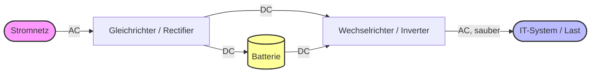

# USV (Unterbrechungsfreie Stromversorgung)

## Definition & Zweck
Eine USV (engl. UPS – Uninterruptible Power Supply) ist ein Gerät, das IT-Systeme bei Stromausfällen, Spannungsschwankungen oder -spitzen mit Notstrom versorgt. Sie überbrückt die Zeit bis zur Wiederherstellung des Netzes oder bis zum geordneten Herunterfahren der Systeme. Ziel ist der Schutz der **Verfügbarkeit** (Schutz vor Datenverlust und Hardware-Schäden).

## Die 3 USV-Typen (nach VFI/VI/VFD)

| Typ | Bezeichnung | Funktionsweise | Einsatzgebiet |
| :--- | :--- | :--- | :--- |
| **Offline (VFD)** | Standby / Voltage and Frequency Dependent | Last wird normalerweise direkt vom Netz versorgt. Bei Stromausfall schaltet die USV in wenigen Millisekunden auf Batterie um. | Private PCs, kleine Peripheriegeräte. |
| **Line-Interactive (VI)** | Voltage Independent | Last wird vom Netz versorgt. Ein AVR (Automatic Voltage Regulator) gleicht Spannungsschwankungen aus. Umschaltung auf Batterie bei Ausfall. | Kleine Server, Arbeitsplätze, Netzwerkkomponenten. |
| **Online (VFI)** | Voltage and Frequency Independent | Last wird **permanent** über einen Wechselrichter aus der Batterie versorgt. Das Netz lädt nur die Batterie. Keine Umschaltzeit (0 ms). | Kritische Server, Rechenzentren, Medizintechnik. |

## Visualisierung: Online-USV (VFI)



*Bei einer Online-USV wird die Last immer über den Wechselrichter versorgt. Ein Netzausfall betrifft die Last nicht, da die Batterie den Gleichrichter ersetzt. Es gibt keine Umschaltzeit.*

## Wichtige Kennzahlen (IHK-relevant)
*   **Nennleistung (VA / W):** Maximale Last, die die USV versorgen kann (z.B. 1500 VA / 900 W). Achtung: VA (Scheinleistung) ≠ W (Wirkleistung).
*   **Überbrückungszeit (Runtime):** Zeit, die die USV bei Volllast überbrücken kann (z.B. 5–15 Minuten). Abhängig von der Batteriekapazität.
*   **Umschaltzeit:** Zeit, bis die USV nach Netzausfall auf Batterie umschaltet (Online = 0 ms, Offline = 2–10 ms).
*   **Autonomiezeit:** Zeit, die das System ohne Netzversorgung laufen kann.

## Kommunikation & Management
Moderne USV-Anlagen verfügen über Schnittstellen zur Überwachung:
*   **USB / RS-232:** Direkte Verbindung zu einem Server.
*   **LAN / SNMP:** Netzwerkfähig. Ermöglicht Monitoring über das Netzwerk (z.B. per Nagios, Zabbix).
*   **Potentialfreie Kontakte:** Für Alarmanlagen oder Gebäudeleittechnik.
*   **Software-Agent:** Fährt das System bei kritischem Batteriestand automatisch geordnet herunter (graceful shutdown).

## Prüfungs-Merksatz
> „Eine USV schützt vor Datenverlust durch Stromausfall. Die **Online-USV** ist der Standard für Server, da sie **0 ms Umschaltzeit** und eine saubere Sinuswelle liefert. Die **Überbrückungszeit** ist begrenzt und muss so dimensioniert sein, dass ein geordnetes Herunterfahren möglich ist.“
```
