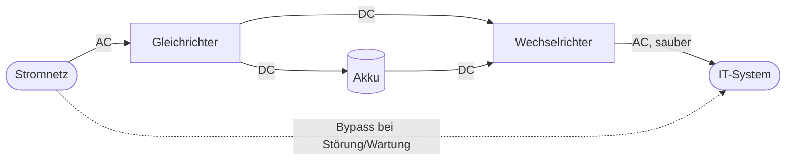

# USV (Unterbrechungsfreie Stromversorgung)

## In 30 Sekunden

- Eine USV (engl. UPS) versorgt IT-Systeme bei **Stromausfall, Spannungseinbrüchen und -spitzen** aus Akkus. Sie überbrückt die Zeit bis zum Wiederkehren des Netzes, bis zum Start eines **Notstromaggregats** oder bis zum **geordneten Herunterfahren**.
- Drei Typen nach EN 62040-3: **Offline = VFD**, **Line-Interactive = VI**, **Online (Doppelwandler) = VFI**.
- Nur die **Online-USV** hat **keine Umschaltzeit** und liefert dauerhaft saubere Spannung und Frequenz → Standard für Server und Rechenzentren.
- Dimensionierung: Leistung in **VA und W** (W = VA · Leistungsfaktor) und **Überbrückungszeit**. Die Software fährt Server per Netzwerk (SNMP) bei Restladung herunter.
- Geprüft: Typen und Abkürzungen 2023S, Berechnung Notstromstart 2025S, USV als HA-Maßnahme 2022W/2024S.

## Kernwissen

### Die drei Typen

| Typ | Kürzel | Funktionsweise | Umschaltzeit | Einsatz |
|---|---|---|---|---|
| **Offline / Standby** | **VFD** – Voltage and Frequency Dependent | Last hängt direkt am Netz. Erst beim Ausfall schaltet ein Relais auf Wechselrichter und Akku um | ca. 4–10 ms | Einzel-PCs, Peripherie |
| **Line-Interactive** | **VI** – Voltage Independent | wie Offline, zusätzlich gleicht ein Spartransformator (**AVR**) Unter- und Überspannung ohne Akku aus | ca. 2–4 ms | kleine Server, Netzwerktechnik |
| **Online / Doppelwandler** | **VFI** – Voltage and Frequency Independent | Gleichrichter → Zwischenkreis/Akku → Wechselrichter. Die Last hängt **immer** am Wechselrichter | **0 ms** | Server, Storage, Rechenzentren, Medizintechnik |

**Merkhilfe:** **D**ependent = abhängig vom Netz (schlechteste), **I**ndependent = unabhängig. VFI ist von **Spannung und Frequenz** unabhängig.

### Line-Interactive vs. Offline (2023S)

| Vorteile Line-Interactive | Nachteile Line-Interactive |
|---|---|
| AVR gleicht Spannungsschwankungen ohne Akku aus → schont den Akku | teurer als Offline |
| kürzere Umschaltzeit | **Frequenz**schwankungen werden nicht ausgeglichen (nur V, nicht F) |
| | weiterhin Umschaltzeit, nicht für kritische Server ideal |

### Aufbau Online-USV (VFI)

Fällt das Netz aus, speist der Akku den Wechselrichter weiter. Die Last merkt nichts. Der **Bypass** überbrückt die USV nur bei einem USV-Defekt oder bei Wartung.

### Kennzahlen

| Kennzahl | Bedeutung | Beispiel |
|---|---|---|
| **Scheinleistung (VA)** | „Gesamtleistung“, für die die USV ausgelegt ist | 3.000 VA |
| **Wirkleistung (W)** | tatsächlich nutzbare Leistung, W = VA · cos φ | 3.000 VA · 0,9 = 2.700 W |
| **Überbrückungszeit** | Laufzeit auf Akku bei gegebener Last | 15 min bei 50 % Last |
| **Umschaltzeit** | Zeit bis zur Akku-Versorgung | Online 0 ms |

Die Laufzeit hängt von der Last ab: halbe Last ergibt deutlich mehr als die doppelte Laufzeit, weil Akkus bei geringem Strom effizienter sind. Herstellertabellen nutzen. In Prüfungsaufgaben wird meist **linear** gerechnet.

### Rechenweg: Wann muss das Notstromaggregat starten? (Muster 2025S)

Gegeben: Bei der aktuellen Last läuft die USV mit vollem Akku 60 min. Bei 30 % Restladung sollen die Server sicher herunterfahren können, das Aggregat braucht 3 min zum Anlaufen.

1. 100 % Ladung ≙ 60 min → 1 % ≙ 0,6 min
2. Reserve 30 % ≙ 18 min
3. Plus Anlaufzeit des Aggregats: 18 + 3 = 21 min
4. 21 min / 60 min = 0,35 → Start des Aggregats spätestens bei **35 %** Ladung

Variante: Last 600 VA an einer 2.400-VA-USV = 25 % Auslastung. Die Laufzeit für diese Last steht im Datenblatt (hier 60 min).

### Anbindung und Management

- **USB/RS-232:** ein direkt verbundener Server fährt herunter.
- **Netzwerkkarte/SNMP:** viele Server und Hypervisor-Hosts werden per Agent (z. B. PowerChute, NUT) gestaffelt heruntergefahren. Überwachung im Monitoring.
- **Redundanz:** zwei USVs an zwei Stromkreisen für die beiden Netzteile eines Servers. Größere RZ: N+1-modulare USV.
- **Wartung:** Akkus altern (Lebensdauer ca. 3–5 Jahre), regelmäßiger Selbsttest und Akkutausch.

## Prüfungsfrage

**Frage:** Für den Serverraum soll eine USV beschafft werden. Welchen Typ empfehlen Sie? Begründen Sie mit der Bezeichnung nach Norm.

**Musterantwort:** Empfohlen wird eine Online-USV (Doppelwandler) der Klasse **VFI**, Voltage and Frequency Independent. Die Server hängen dauerhaft am Wechselrichter, der aus dem Gleichstromzwischenkreis bzw. Akku gespeist wird. Spannung und Frequenz am Ausgang sind damit unabhängig vom Netz. Bei einem Netzausfall gibt es **keine Umschaltzeit**, und auch Spannungsspitzen, Einbrüche und Frequenzschwankungen werden vollständig ausgefiltert. Offline-USVs (VFD) und Line-Interactive-USVs (VI) schalten erst um, und VI gleicht Frequenzschwankungen nicht aus.

## Falle

- VFI und VFD vertauschen. **I**ndependent = Online = die beste Klasse.
- USV nur in VA dimensionieren und die Wirkleistung in W vergessen.
- Die USV als Ersatz für Langzeitversorgung verkaufen. Für Stunden braucht es ein **Notstromaggregat**, die USV überbrückt nur dessen Anlaufzeit.
- Bei der Notstrom-Rechnung die Anlaufzeit des Aggregats nicht zur Reserve **addieren**.
- Ohne Shutdown-Software: Der Akku läuft leer und die Server gehen trotzdem hart aus.
- Bypass mit Normalbetrieb verwechseln. Über den Bypass ist die Last **ungeschützt**.

## Merksatz

**„VFI = immer am Wechselrichter, null Millisekunden. Die USV überbrückt, das Aggregat versorgt.“**

## Verwandt

- [HA-Hochverfügbarkeit](ha-hochverfuegbarkeit.md)
- [Verfügbarkeit & Kennzahlen](verfuegbarkeit-kennzahlen.md)
- [Server-Hardware](../../Komponenten/server-hardware.md) – redundante Netzteile
- [Energieeffizienz & Stromkosten](energieeffizienz-stromkosten.md) – VA, W, Wirkungsgrad
- [Monitoring](monitoring.md) – USV per SNMP überwachen
- [Disaster Recovery & Notfallkonzept](backup/disaster-recovery-notfallkonzept.md)
- [Lektion 03 Verfügbarkeit](../../analyse-der-exams/03_Verfuegbarkeit_Ausfallsicherheit.md)
